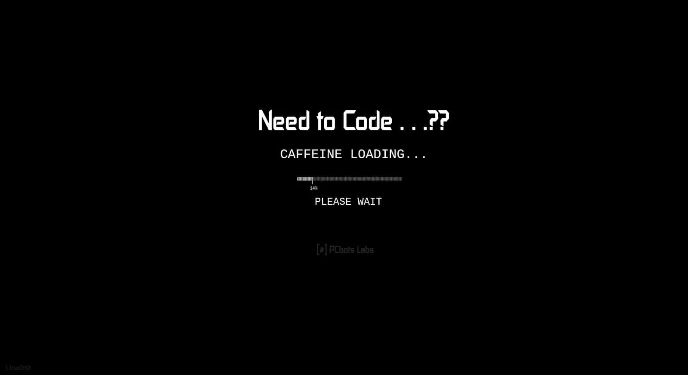

  

# Hi, I'm Saza! 

### 🎓 Informatics Student | Aspiring Developer | UI Designer

Welcome to my GitHub profile!

I'm an Informatics student with an interest in technology, programming, and interface design.

- Interested in Software Development and Programming
- Passionate about UI Design and creating intuitive user interfaces
- Currently exploring Web Development and Digital Design
- Always learning, creating, and improving my skills

---

**"Turning ideas into meaningful digital experiences."**

---
### GitHub Stats

  
  

---

### Contact Me

  

<h2 align="left">🛠️ Tech Stack</h2>

  

<h2 align="left">📊 GitHub Statistics</h2>

  
  

  

<h2 align="left">🚀 Projects</h2>

<table>
<tr>
<td width="50%">
<h3>🍰 Jone Bakery</h3>

Flutter-based bakery application.

</td>
<td width="50%">
<h3>🐍 Snake Game</h3>

My own classic Snake mini game.

</td>
</tr>
</table>

<h2 align="left">📫 Connect With Me</h2>

  <i>"Turning ideas into meaningful digital experiences."</i>

